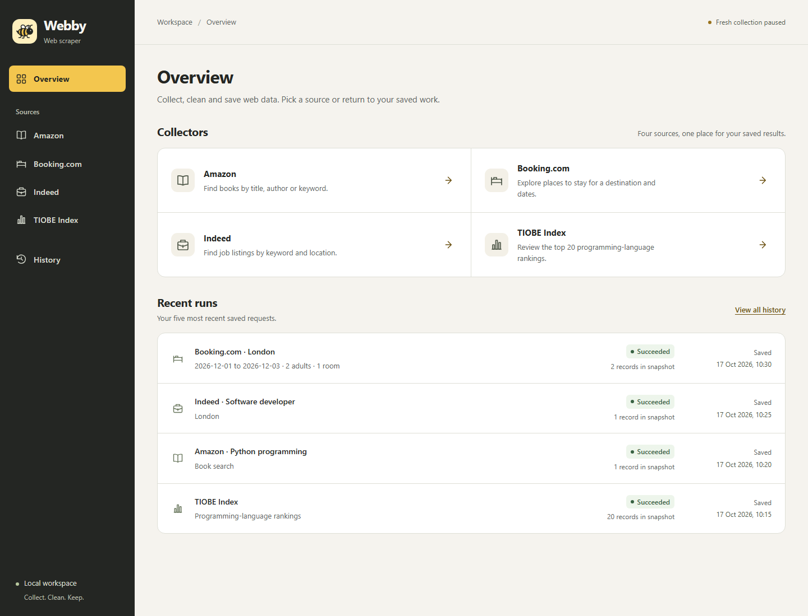
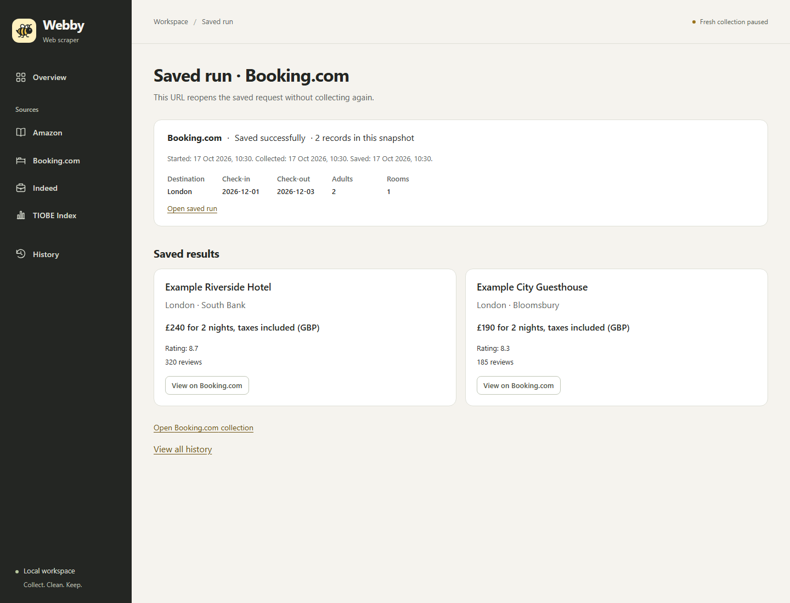
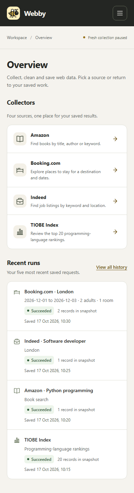
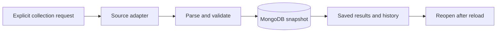

# Web Scraper

**Collect once. Keep the context. Reopen the results.**

**Webby** is a local workspace for Amazon books, Booking.com stays, Indeed jobs and TIOBE programming-language rankings. It turns source-specific collection into validated records, durable MongoDB snapshots and a responsive interface for saved results and history.

Built with **React · Vite · Bootstrap · Express · MongoDB · Python · Playwright · ZenRows**.

## Workspace preview

These captures show the actual local interface with **illustrative sample data**. They do not contain scraped records or represent a live collection; the sample data is not bundled into the application database.



_Overview brings the four collectors and recent saved work into one workspace._



_Saved runs retain the request context and outcome so results can be reopened after reload._

<details>
<summary>Mobile workspace</summary>



_The same workspace adapts to a narrow screen with drawer navigation._

</details>

## What it does

- **Collects by source:** book queries, stay dates/occupancy, job keywords/location and programming-language rankings.
- **Cleans without guessing:** validates identities and URLs, normalizes text, removes duplicates and preserves qualified prices and missing values.
- **Keeps saved work:** immutable successful snapshots, separate failed attempts, stable saved-run URLs and filterable history.
- **Makes activity visible:** a source-aware header shows an observed collection and its verified outcome; saved-data browsing stays available with fresh collection paused.

## How it works



Fresh collection must be deliberately enabled. Opening or refreshing a view reads saved data instead of starting this pipeline. See [architecture](docs/architecture.md) for the separate read path, runtime ownership and failure handling.

**A new clone starts with an empty database.** Scraped records, credentials, local database volumes and generated artifacts are not distributed. Empty source/history views are expected until a real collection has been saved locally; test fixtures do not populate the app.

## Run locally

After completing [setup](docs/setup-verification.md), run these commands from the project folder in PowerShell:

```powershell
docker compose up -d mongo
& .\scripts\Run.ps1 api-offline
```

In a second PowerShell window:

```powershell
& .\scripts\Run.ps1 web
```

Open [Webby](http://127.0.0.1:5174). The API listens on loopback port 3001 and MongoDB on loopback port 27017. `api-offline` disables fresh collection and does not load `.env`; it preserves existing process-level configuration overrides. Reading saved data needs no provider key. Stop each application with `Ctrl+C`; `docker compose stop mongo` stops the database without deleting its volume.

Opening or refreshing a view performs local saved-data reads and never starts collection. Saved covers and language icons can load from their original image hosts, and result links lead to external sites when selected. Offline collection mode therefore does not imply browser-wide network isolation.

## Source contracts

| Source      | Inputs                                            | Saved records                                                                                    | Dashboard transport                                       |
| ----------- | ------------------------------------------------- | ------------------------------------------------------------------------------------------------ | --------------------------------------------------------- |
| Amazon      | Book title, author or keyword                     | Title, authors, source URL, cover and available qualified price/rating/review information        | ZenRows Fetch and Node/Cheerio parsing                    |
| Booking.com | Destination, check-in/check-out, adults and rooms | Hotel name and source URL, with available stay price/currency, rating, review count and location | ZenRows Browser Sessions and Python/BeautifulSoup parsing |
| Indeed      | Keyword and location                              | Job title, company, location and canonical job URL                                               | ZenRows Fetch and Python/BeautifulSoup parsing            |
| TIOBE Index | No search input                                   | Twenty ordered programming-language rankings with available icons                                | Direct public HTTP and Node/Cheerio parsing               |

Parsers validate required fields and URLs, normalize text and remove duplicates. Missing optional values remain unavailable. Prices retain their source qualifications; the app does not invent currency, convert stay prices to nightly prices or infer tax inclusion.

## Collection and persistence

The saved-data launcher shows **Fresh collection paused** and disables **Collect fresh data**. To deliberately enable real collection, configure the ignored local `.env` from the blank [.env.example](.env.example) and use `scripts/Run.ps1 api`. This command enables collection and loads local configuration. It can send requests and consume provider allowance; choose source inputs and spending limits before using it. Never expose a key in command arguments, screenshots, logs or frontend code.

Only an explicit collection submission creates a new run. One collection runs at a time. Reusing the same request identifier reopens that attempt instead of repeating it. Each successful run saves an immutable snapshot; a later failure is a separate outcome and preserves previous results. There is no scheduling, automatic retry or collection on page load.

The header names an observed active source, such as **Collecting Indeed…**, and shows a verified success or failure for ten seconds. It then returns to availability. Status checks use local GET requests. Other-tab activity is discovered by polling, so a run that starts and finishes between idle polls may be missed; same-tab accepted runs notify immediately.

History and saved-run URLs reopen recorded inputs, status, counts and timestamps. Snapshots do not expire automatically and are not presented as continuously refreshed data. Legacy cache records remain readable with an honest unknown original collection time where necessary. Keep the Mongo volume: removing it deletes saved work.

## Tooling and checks

The selected environment is Windows AMD64 with Node 24.22.0, pnpm 11.28.6, Python 3.14.8 and MongoDB 8.0.34. JavaScript dependencies use `pnpm-lock.yaml`; Python dependencies use hash-locked requirements. The Mongo image is digest-pinned in `compose.yaml`.

```powershell
& .\scripts\Run.ps1 check
& .\scripts\Run.ps1 build
& .\scripts\Run.ps1 e2e
```

The complete check requires the separate verification lock, installed Playwright Chromium and native Poppler. See [setup prerequisites](docs/setup-verification.md). Controlled tests use synthetic data, blocked external requests and disposable integration namespaces; they do not seed the application database.

Independent [Python collector commands](collectors/python/README.md) and [browser/PDF utilities](tools/browser/README.md) are also available. Their live commands make external requests; successful PDF export alone does not certify readability.

This is a local application, not an authenticated public service. Source markup, provider access and allowances can change. See [verification and operational limits](docs/verification.md) before a live demonstration or a deployment decision.

## Documentation

| Guide                                                | Purpose                                                                 |
| ---------------------------------------------------- | ----------------------------------------------------------------------- |
| [Setup and verification](docs/setup-verification.md) | Pinned runtimes, locked dependencies, local startup and offline checks. |
| [Demo runbook](docs/demo-runbook.md)                 | A saved-data walkthrough, presentation sequence and recovery steps.     |
| [Architecture](docs/architecture.md)                 | Collection/read flows, public API, persistence and failure boundaries.  |
| [Verification](docs/verification.md)                 | Actual local checks, bounded live evidence and remaining limits.        |
| [Source provenance](docs/provenance.md)              | Pinned source references, adaptations and observed licensing metadata.  |
