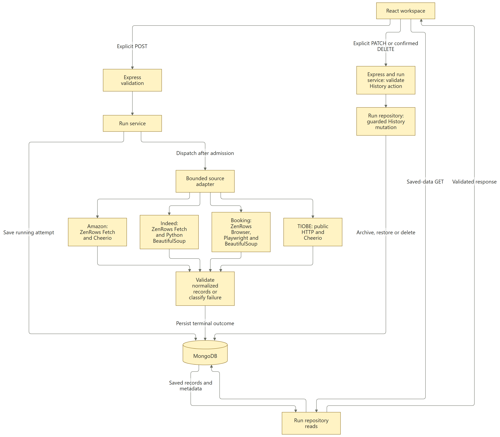

# Architecture

## Goal

Keep collection, deterministic cleaning, durable snapshots and saved-data presentation separate so browsing history cannot accidentally start scraping.

## Context Pointers

- [API routes](../apps/api/app.js), [run service](../apps/api/run-service.js), [run contracts](../apps/api/run-contract.js) and [Mongo repository](../apps/api/mongo-runs.js).
- [Node parsers](../apps/api/parsers.js), [HTTP transport](../apps/api/transport.js) and [Python adapter](../apps/api/python-collectors.js).
- [Python collectors](../collectors/python/README.md), [web application](../apps/web/src/App.jsx) and [verification](verification.md).

## Constraints

This is a single-PC application. The API and database bind to loopback, and the API validates local Host/Origin values. This is not user authentication, multi-tenant isolation or authorization for public hosting. No scheduler, queue service, audience analysis or LLM is part of the architecture.

Credentials remain in the server/CLI environment. The frontend receives validated public records and safe error messages, not provider credentials or raw worker diagnostics. Collection is disabled unless explicitly enabled; saved-data GET routes never invoke collectors.

## Components and flow

Collection, browsing and history management use separate paths. Only an explicit, enabled POST can dispatch a collector; GET requests read saved data or runtime status. Explicit PATCH/confirmed DELETE requests manage terminal runs through the service/repository without entering a source adapter.

[Open the scalable architecture diagram](images/architecture.svg) · [Edit the Mermaid source](diagrams/architecture.mmd)

This image is generated locally from the editable source. Use the [diagram generation guide](diagrams/README.md) to regenerate and check both formats. Open the scalable version to inspect labels on a narrow screen.

The terminal record preserves either validated snapshot data or a safe failure outcome. The read path never falls back to collection, and a failed new attempt does not replace an earlier successful snapshot. Health/activity GETs are separate in-memory runtime reads and are not shown as database reads in this diagram.

1. **React/Vite/Bootstrap:** source forms, Overview, source results, saved-run pages and filterable/paginated history. Vite proxies `/api` to the local Express server.
2. **Express boundary:** validates local access, request shape and source inputs. `POST /api/runs` is the only dashboard route that admits fresh collection.
3. **Run service:** accepts one active collection, creates the durable running attempt, dispatches the source adapter and persists a validated terminal outcome. Request identifiers provide idempotent replay; conflicting reuse is rejected.
4. **Source adapters:** Amazon uses Node transport/Cheerio with ZenRows Fetch; Indeed uses a bounded Python worker with ZenRows Fetch; Booking uses a bounded Python Playwright session with ZenRows Browser Sessions; TIOBE uses direct public HTTP/Cheerio. Pure parsing and record validation are separate from external I/O.
5. **MongoDB:** stores run metadata, requested inputs, terminal outcome and immutable successful data. Read paths return saved snapshots rather than making fresh requests.

The independent Python CLI also offers standard and managed Amazon/Indeed/Booking modes. Browser/PDF utilities are separate CLI tools; they do not populate dashboard history.

## API surface

| Method and route                                               | Behavior                                                                                                                                                   |
| -------------------------------------------------------------- | ---------------------------------------------------------------------------------------------------------------------------------------------------------- |
| `GET /api/health`                                              | Runtime health, collection availability and nullable `activeRun: {id, source}`. It performs no database or collector work.                                 |
| `POST /api/runs`                                               | Admit `{source, inputs, requestId}`; return a running attempt or an idempotent existing attempt. Disabled, busy and invalid requests fail explicitly.      |
| `GET /api/runs?source=...&visibility=...&limit=...&cursor=...` | Saved history; optional source, active/archived visibility (default active), cursor and limit 1–50 (default 20).                                           |
| `GET /api/runs/latest?source=...`                              | Latest successful saved snapshot for a source, or `null`.                                                                                                  |
| `GET /api/runs/:id`                                            | Exact saved attempt, including requested inputs, status, timestamps and data/error.                                                                        |
| `PATCH /api/runs/:id`                                          | JSON `{archived:boolean}` archives/restores a terminal run and returns its DTO. Running records return 409; deleted records return 410.                    |
| `DELETE /api/runs/:id`                                         | JSON `{confirm:true}` permanently removes a terminal snapshot, returning `{id,deleted:true}`. Running records return 409; repeated deletion is idempotent. |
| `GET /api/books/amazon?q=...`                                  | Compatibility saved-cache read for matching Amazon inputs; 404 when absent.                                                                                |
| `GET /api/tiobe`                                               | Compatibility saved-cache read; 404 when absent.                                                                                                           |

Supported source identifiers are `amazon`, `booking`, `indeed` and `tiobe`. The four [input/output contracts](../README.md#source-contracts) remain source-specific. Optional source fields remain nullable; cleaning does not fabricate values.

## Storage and recovery

`collectionruns` holds distinct attempts with `running`, `succeeded` or `failed` status. Successful data is kept with collection/save metadata. A later failure does not overwrite an earlier successful snapshot. There is no automatic expiry or deletion. An envelope archive timestamp controls visibility without changing the snapshot. Archived records remain directly readable but are excluded from latest results, previous-success fallback and default history. Filters apply before pagination and latest selection.

Existing `collectionbatches` appear as legacy saved runs. Archive/restore metadata lives separately in `collectionlegacyrunstates`, preserving original legacy document values. Unknown collection time stays honest; an actual creation time can be shown as save time. New installations start empty.

Confirmed permanent deletion replaces the current envelope with `{id,deletedAt}` or the legacy envelope with `{key,deletedAt}`, retaining MongoDB's `_id`. This single-document transition removes the payload, inputs and original timestamps atomically while preserving the duplicate-request barrier. Deleted URLs and UUID replays return410; the unique current ID still prevents reuse. Explicit terminal-state predicates reject management of running attempts. Minimal identity retention is not secure erasure of database journals or backups. A concurrent read may observe the snapshot immediately before deletion; it cannot dispatch collection again.

History management follows UI → Express/service → repository → MongoDB and never enters a source adapter, as the separate management path in the diagram shows. These explicit PATCH/DELETE writes use the same loopback access checks and remain available while fresh collection is paused.

A `collectionruntimeowners` guard refuses a second live runtime on the same database. Normal shutdown stops admission, cancels/cleans up work and releases ownership after confirmed cleanup. On restart, abandoned running attempts become interrupted failures; scraping is never resumed automatically. Uncertain cleanup or terminal persistence blocks further admission rather than risking overlapping work.

Keep the Docker volume to preserve history. Stopping MongoDB retains it; removing the volume destroys it. Code rollback does not require deleting saved collections.

## Header activity

The persistent header polls read-only health, using 1.5-second intervals while tracking work and five-second intervals while idle. Focus/visibility changes trigger checks; hidden tabs avoid regular polling. Same-tab validated admissions notify it immediately.

An active ID disappearing does not prove success. The header reads that saved run and announces only a validated succeeded/failed outcome for ten seconds. Unknown or failed status reads show **Collection status unavailable**. A new active run takes precedence. A short other-tab run entirely between polls can be missed.

## Done When

Opening or refreshing a view only reads saved data; explicit submissions alone can start enabled collection; successful snapshots survive later failures and reloads; invalid input, upstream failure, cancellation, persistence failure and cleanup uncertainty have distinct tested outcomes. See [verification evidence](verification.md) for observed coverage and limits.
